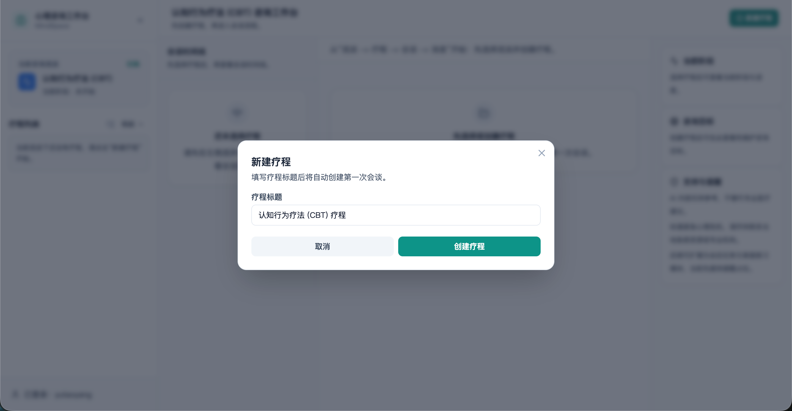
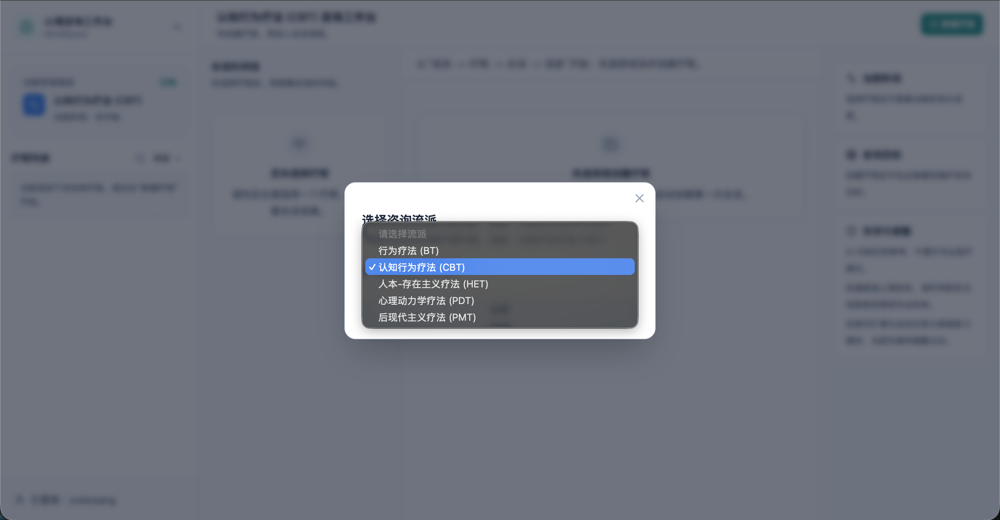
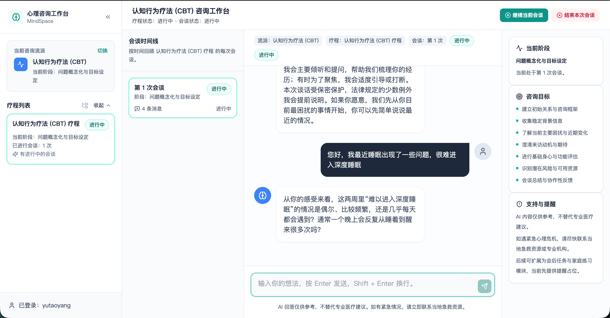
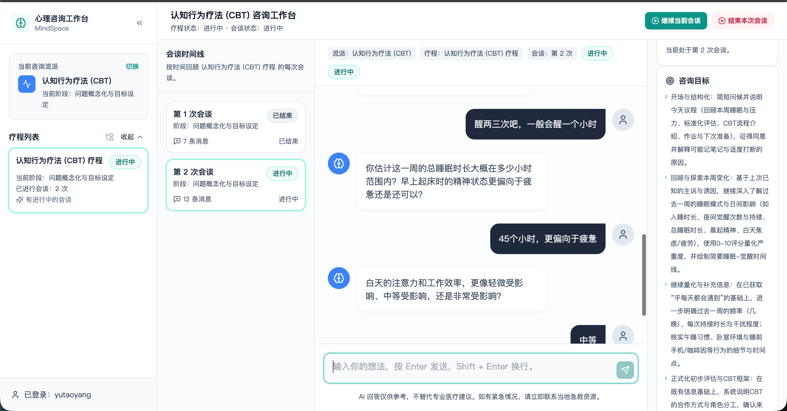

# PsicoIA Web

PsicoIA Web provides a browser interface for the migrated multi-session counseling workflow based on the PsychAgent research codebase. It includes a frontend and a local backend for demos, trial use, and lightweight development.

[Português (Brasil)](README.pt-BR.md)

## Features

- Sign up and sign in.
- Create courses by counseling school.
- Automatically start the first session.
- Continue a conversation during a session.
- End a session and start the next one.
- Complete a course.

## Screenshots

### Create course



### Switch school



### Consultation view



### Follow-up session



## Deploy the counselor model

If you need to deploy the counselor model service before using the web workspace, start the `sglang` server. Example:

```bash
nohup python -m sglang.launch_server \
    --model-path /path/to/psychagent-checkpoint \
    --trust-remote-code \
    --port 30000 \
    --tp 8 \
    --host 0.0.0.0 \
    > /path/to/logs/sglang_server.log 2>&1 &
```

Update `base_url` in [`../../configs/baselines/psychagent_sglang_local.yaml`](../../configs/baselines/psychagent_sglang_local.yaml) to match your model service endpoint.

## Start from the repository root

Create `.env.local` in the project root, for example:

```bash
SGLANG_API_KEY=your-sglang-key
PSYCHAGENT_EMBEDDING_API_KEY=your-embedding-key
BACKEND_PORT=8000
FRONTEND_PORT=5173
BACKEND_HOST=localhost
```

Start the backend and frontend in separate terminals:

```bash
./run_backend.sh
./run_frontend.sh
```

Default endpoints:

```text
Frontend: http://localhost:5173
Backend:  http://localhost:8000
Health:   http://localhost:8000/health
```

## Manual setup

From `src/web`:

```bash
npm install
python3 -m venv .venv
source .venv/bin/activate
python3 -m pip install --upgrade pip
python3 -m pip install -r requirements.txt
```

Set the required keys:

```bash
export SGLANG_API_KEY="your-sglang-key"
export PSYCHAGENT_EMBEDDING_API_KEY="your-embedding-key"
```

Optional config overrides:

```bash
export PSYCHAGENT_WEB_BASELINE_CONFIG="configs/baselines/psychagent_sglang_local.yaml"
export PSYCHAGENT_WEB_RUNTIME_CONFIG="configs/runtime/psychagent_sglang_local.yaml"
```

Start the backend:

```bash
uvicorn main:app --reload --host 0.0.0.0 --port 8000
```

In another terminal, start the frontend:

```bash
npm run dev
```

## Usage

1. Open the web app and sign in or register.
2. Choose a counseling school.
3. Create a course.
4. Start a conversation in the session view.
5. End the current session and move to the next one.
6. Mark the course as complete when the process is finished.

## Configuration

The frontend uses `http://localhost:8000` by default. Override it before starting the development server if needed:

```bash
VITE_API_BASE=http://127.0.0.1:8001 npm run dev
```

Common backend environment variables:

- `PSYCHAGENT_WEB_BASELINE_CONFIG`
- `PSYCHAGENT_WEB_RUNTIME_CONFIG`
- `DB_URL`
- `SGLANG_API_KEY`
- `PSYCHAGENT_EMBEDDING_API_KEY`

The default local database file is `data.db`.

## Build

```bash
npm run build
npm run preview
```

Build output is written to `dist/`.

## Requirements and troubleshooting

Requirements: Node.js 18+, npm, Python 3.10+, a configured model service, and the required API or embedding keys.

If the page loads but requests fail, check that the backend is running on port `8000` and that `VITE_API_BASE` is correct. If the backend reports a missing key, check `SGLANG_API_KEY` and `PSYCHAGENT_EMBEDDING_API_KEY`. The page styles depend on the Tailwind CDN; without external CDN access, styling may be incomplete.

If native dependencies remain problematic after `npm install`, try:

```bash
npm install --include=optional
```

## Project layout

- `src/`: frontend application.
- `backend/`: Web API.
- `main.py`: backend entry point.
- `requirements.txt`: backend dependencies.
- `package.json`: frontend dependencies and scripts.

## Related documentation

- [Project README](../../README.md)
- [Project README in Brazilian Portuguese](../../README.pt-BR.md)
- [Source code guide](../README.md)
