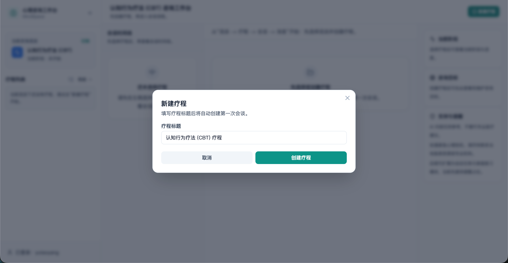
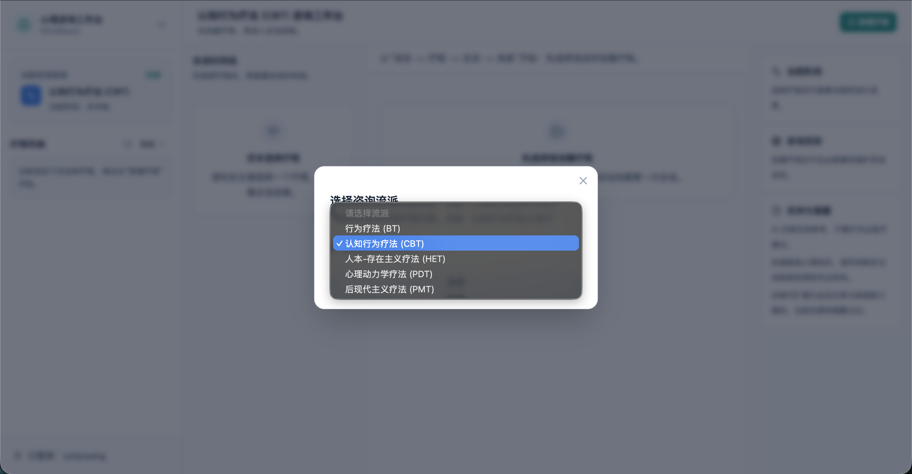
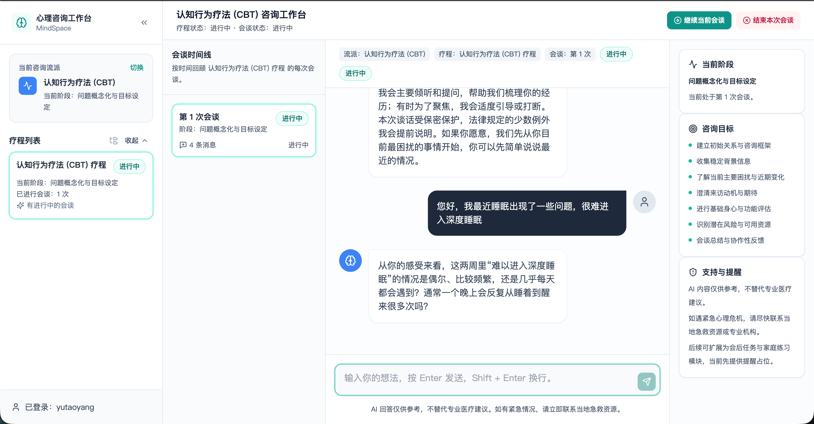
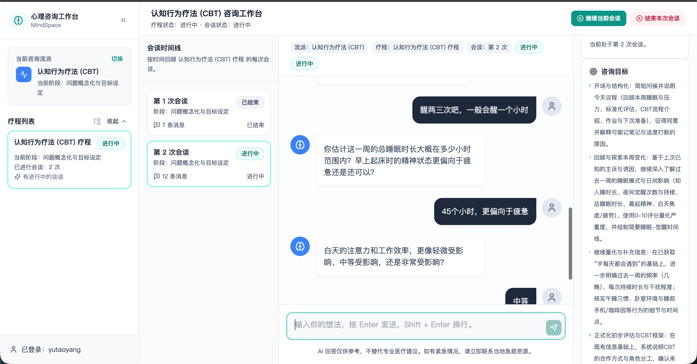

# PsicoIA Web

O PsicoIA Web é uma interface local de demonstração para o fluxo de pesquisa de múltiplas sessões do PsychAgent. A interface está disponível em português brasileiro e inglês; o seletor de idioma fica no canto superior direito e a seleção é salva neste navegador. O idioma selecionado também orienta respostas geradas quando o backend aceita o campo de idioma.

[English](README.md)

## Recursos

- Criar uma conta e entrar.
- Criar percursos por abordagem.
- Iniciar automaticamente a primeira sessão.
- Continuar uma conversa durante a sessão.
- Encerrar uma sessão e iniciar a próxima.
- Concluir um curso.

## Capturas de tela

### Criar curso



### Trocar abordagem



### Visão da consulta



### Sessão de acompanhamento



## Implantar o modelo terapeuta

Se precisar implantar o serviço do modelo terapeuta antes de usar o espaço web, inicie o servidor `sglang`. Exemplo:

```bash
nohup python -m sglang.launch_server \
    --model-path /path/to/psychagent-checkpoint \
    --trust-remote-code \
    --port 30000 \
    --tp 8 \
    --host 0.0.0.0 \
    > /path/to/logs/sglang_server.log 2>&1 &
```

Atualize `base_url` em [`../../configs/baselines/psychagent_sglang_local.yaml`](../../configs/baselines/psychagent_sglang_local.yaml) para corresponder ao endpoint do serviço do modelo.

## Iniciar a partir da raiz do repositório

Crie o arquivo `.env.local` na raiz do projeto. Exemplo:

```bash
SGLANG_API_KEY=your-sglang-key
PSYCHAGENT_EMBEDDING_API_KEY=your-embedding-key
BACKEND_PORT=8000
FRONTEND_PORT=5173
BACKEND_HOST=localhost
```

Inicie o backend:

```bash
./run_backend.sh
```

Em um segundo terminal, inicie o frontend:

```bash
./run_frontend.sh
```

O endpoint padrão do backend é:

```text
http://localhost:8000
```

O frontend é servido em `http://localhost:5173`; o endpoint de saúde do backend é `http://localhost:8000/health`.

## Configuração manual

No diretório `src/web`, instale as dependências do frontend:

```bash
npm install
```

Prepare o ambiente Python do backend:

```bash
python3 -m venv .venv
source .venv/bin/activate
python3 -m pip install --upgrade pip
python3 -m pip install -r requirements.txt
```

Defina as chaves necessárias:

```bash
export SGLANG_API_KEY="your-sglang-key"
export PSYCHAGENT_EMBEDDING_API_KEY="your-embedding-key"
```

Substituições de configuração opcionais:

```bash
export PSYCHAGENT_WEB_BASELINE_CONFIG="configs/baselines/psychagent_sglang_local.yaml"
export PSYCHAGENT_WEB_RUNTIME_CONFIG="configs/runtime/psychagent_sglang_local.yaml"
```

Inicie o backend:

```bash
uvicorn main:app --reload --host 0.0.0.0 --port 8000
```

Em outro terminal, inicie o frontend:

```bash
npm run dev
```

## Uso

1. Abra o aplicativo web e entre ou cadastre-se.
2. Escolha uma abordagem.
3. Crie um percurso.
4. Inicie uma conversa na tela da sessão.
5. Encerre a sessão atual e avance para a próxima.
6. Marque o percurso como concluído quando o processo terminar.

## Configuração

Por padrão, o frontend usa `http://localhost:8000`. Se necessário, substitua o endereço antes de iniciar o servidor de desenvolvimento:

```bash
VITE_API_BASE=http://127.0.0.1:8001 npm run dev
```

Variáveis de ambiente comuns do backend:

- `PSYCHAGENT_WEB_BASELINE_CONFIG`
- `PSYCHAGENT_WEB_RUNTIME_CONFIG`
- `DB_URL`
- `SGLANG_API_KEY`
- `PSYCHAGENT_EMBEDDING_API_KEY`

O arquivo padrão do banco de dados local é `data.db`.

## Build

Gere o build do frontend:

```bash
npm run build
```

Para visualizar o build de produção:

```bash
npm run preview
```

Os arquivos de build são gravados em:

```text
dist/
```

## Requisitos e solução de problemas

Requisitos: Node.js 18+, npm, Python 3.10+, um serviço de modelo configurado e as chaves de API ou de embeddings necessárias.

Se a página carregar, mas as solicitações falharem, confira se o backend está em execução na porta `8000` e se `VITE_API_BASE` está correto. Se o backend informar que falta uma chave, confira `SGLANG_API_KEY` e `PSYCHAGENT_EMBEDDING_API_KEY`. Os estilos da página dependem do CDN do Tailwind; sem acesso externo ao CDN, a apresentação pode ficar incompleta.

Se dependências nativas continuarem apresentando problemas após `npm install`, tente:

```bash
npm install --include=optional
```

## Estrutura do projeto

- `src/`: aplicativo frontend;
- `backend/`: API web;
- `main.py`: ponto de entrada do backend;
- `requirements.txt`: dependências do backend;
- `package.json`: dependências e scripts do frontend.

## Documentação relacionada

- [README do projeto](../../README.md)
- [README do projeto em português brasileiro](../../README.pt-BR.md)
- [Guia do código-fonte](../README.pt-BR.md)
